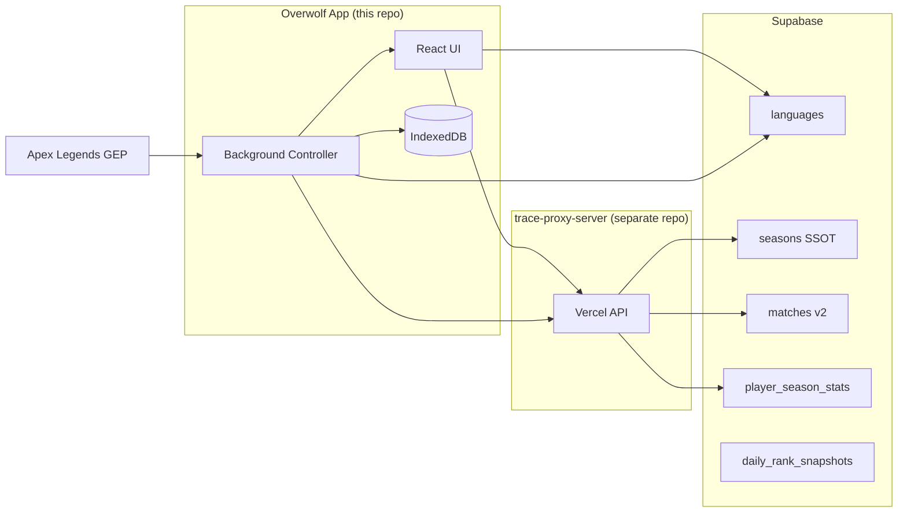

# ApexTrace

**Repository:** https://github.com/sjbong0904/ApexTrace-app  
**Current version:** `0.0.15` — see [docs/RELEASE_NOTES.md](docs/RELEASE_NOTES.md)

Apex Legends match tracking, movement path visualization, and stats overlay built as an [Overwolf](https://www.overwolf.com/) desktop app. ApexTrace listens to in-game events (GEP), records match data locally, syncs history to the cloud, and presents analytics across a second-screen desktop window and an in-game overlay.

---

## Architecture overview

ApexTrace is split across three layers. This repo contains the **Overwolf client app** and **Supabase schema migrations**. The **Vercel API proxy** lives in a separate repository.



| Layer | Role |
|-------|------|
| **Overwolf app** | GEP event capture, match session state, local cache, UI |
| **Vercel proxy** | Mozambique API proxy, player search, match upload/download, CORS-safe backend |
| **Supabase** | i18n strings, normalized match storage (v2), season stats payloads, name aliases, rank snapshots |

Default proxy URL: `https://trace-proxy-server.vercel.app/api` (configured in `public/background/config.js`).

---

## Overwolf windows

Defined in [`manifest.json`](manifest.json):

| Window | File | Purpose |
|--------|------|---------|
| `background` | `background.html` | Hidden controller — GEP, hotkeys, match lifecycle, cloud sync |
| `desktop` | `index.html` | Second-screen window (native OS window, `desktop_only`) |
| `in_game` | `index.html` | Transparent in-game overlay (`in_game_only`) |
| `worker` | `worker.html` | Small helper window for monitor / display detection |

**Hotkeys** (configurable in Settings):

| Hotkey | Default | Action |
|--------|---------|--------|
| `toggle_desktop_window` | `Ctrl+Shift+=` | Show/hide second-screen window |
| `toggle_in_game_window` | `Ctrl+Shift+-` | Show/hide in-game overlay |

Target game: Apex Legends (`game_id: 21566`).

---

## Data flow

### During a match

1. **Background** subscribes to Overwolf GEP events via [`public/background/events.js`](public/background/events.js).
2. Match state is held in `window.Store` ([`public/background/main.js`](public/background/main.js)): map, mode, legend, combat log, movement path, loadout changes, etc.
3. On match end, [`public/background/services/matchService.js`](public/background/services/matchService.js) finalizes the session and [`public/background/repository.js`](public/background/repository.js) POSTs to the proxy (`/history`).

### History & stats

1. React UI ([`src/App.tsx`](src/App.tsx)) loads player stats and match history through the proxy (`/apex-stats`, `/history`, `/search-candidates`).
2. Responses are normalized by [`src/utils/matchNormalizer.ts`](src/utils/matchNormalizer.ts) so the frontend keeps a stable shape across legacy archives and v2 rows.
3. Recent matches are cached in **IndexedDB** via [`src/utils/LocalDB.ts`](src/utils/LocalDB.ts).
4. Large archives sync progressively in the background as **summary-only** pages (`view=summary`); match detail loads on expand.

### Match storage

New matches are stored as one row per match in `public.matches`. Legacy `match_archives` is deprecated on the read path.

| Doc | Contents |
|-----|----------|
| [docs/ARCHITECTURE.md](docs/ARCHITECTURE.md) | **Shipped:** summary/detail split, seasons SSOT, `player-stats` `payload.matches` + client aggregation |

---

## Tech stack

| Area | Stack |
|------|-------|
| UI | React 19, TypeScript, Vite 7 |
| Charts | Recharts |
| i18n | i18next + Supabase `languages` table |
| Theming | CSS variables via [`src/theme/`](src/theme/) (dark / light) |
| Background | Vanilla JS modules on `window` (Overwolf background page) |
| Local storage | IndexedDB |
| Cloud DB | Supabase (Postgres) |
| Backend API | Vercel serverless (separate `trace-proxy-server` repo) |

---

## Project structure

```
apex-trace/
├── manifest.json              # Overwolf app manifest (version, windows, hotkeys, permissions)
├── index.html                 # Desktop + in-game UI entry
├── background.html            # Background controller entry
├── worker.html                # Display helper entry
├── uninstall.html / .js       # Uninstall survey window
│
├── src/                       # React frontend (TypeScript)
│   ├── App.tsx                # Main shell: sidebar, map, tabs, match list
│   ├── main.tsx               # Entry — Overwolf → App, browser → SimpleWebApp
│   ├── components/            # UI (MapVisualizer, StatisticsTab, RankProgressChart, …)
│   ├── theme/                 # ThemeProvider, dark/light token sets
│   ├── hooks/                 # useWindowAutoResize, …
│   ├── utils/                 # helpers, LocalDB, matchNormalizer, matchMode, gepStatus, rankSnapshots, historySync
│   ├── lib/                   # supabase client, loadLanguages
│   ├── constants/             # APP_LANGUAGES (BCP 47 codes)
│   ├── web/                   # Browser-only preview (SimpleWebApp + api.ts)
│   └── types.ts               # Shared TypeScript types
│
├── public/background/         # Overwolf background controller (JavaScript)
│   ├── main.js                # Window control, Store, game lifecycle, hotkeys
│   ├── events.js              # GEP event router (combat, match_info, revive, …)
│   ├── repository.js          # Proxy client (search, history save/fetch, address book)
│   ├── config.js              # PROXY_BASE_URL
│   ├── utils.js               # Name/mode normalization, helpers
│   └── services/
│       ├── apiService.js      # Stats & history fetch
│       ├── matchService.js    # Match finalization & upload
│       └── mapService.js      # Map metadata
│
├── scripts/
│   ├── locale-seeds/          # Translation source JSON (10 languages, BCP 47)
│   ├── seed-languages.ts      # Push locale seeds → Supabase
│   ├── seed-weapons.ts        # Push weapon catalog → Supabase
│   ├── seed-teammate-test-data.ts  # Dev-only fake teammate matches for UI testing
│   └── generate-zh-tw.mjs     # Regenerate zh-TW from zh-CN
│
├── supabase/migrations/       # Postgres schema (languages, matches v2, seasons, player_season_stats)
├── docs/
│   ├── README.md              # Docs hub
│   ├── RELEASE_NOTES.md       # Version changelog
│   ├── ROADMAP.md             # Product + Overwolf API future plans
│   ├── ARCHITECTURE.md        # Match data V3 (shipped)
│   ├── WEAPON-STATS.md        # Weapons tab metrics
│   ├── NICKNAME-SEARCH.md     # Alias / exact search / keep-alive
│   ├── QA.md                  # Overwolf manual QA checklist
│   └── LAUNCH.md              # Phase 1 launch (infra / store / organic / week-2)
│
└── dist/                      # Production build output (gitignored) — load as unpacked extension
```

---

## Requirements

- **Node.js 20+**
- **Overwolf client** — for running the unpacked extension
- **Supabase project** — apply migrations in `supabase/migrations/`
- **Vercel proxy** — deployed separately (`trace-proxy-server`); not included in this repo

---

## Setup

```bash
npm install
cp .env.example .env          # optional; needed for seed:languages only
npm run dev                   # Vite dev server (browser preview via SimpleWebApp)
npm run build                 # Output to dist/
```

### Load in Overwolf (unpacked)

1. Run `npm run build`.
2. In Overwolf → Settings → Support → Development options → Load unpacked extension.
3. Select the `dist/` folder.

For local proxy development, set `window.PROXY_BASE_URL` or edit [`public/background/config.js`](public/background/config.js) before building.

---

## Scripts

| Command | Description |
|---------|-------------|
| `npm run dev` | Vite dev server |
| `npm run build` | TypeScript check + production build → `dist/` |
| `npm run preview` | Preview production build |
| `npm run lint` | ESLint |
| `npm run seed:languages` | Push `scripts/locale-seeds/*.json` to Supabase |
| `npm run seed:weapons` | Push weapon catalog seed → Supabase `public.weapons` |
| `npm run seed:teammate-test` | Insert dev-only fake teammate matches (requires service role key) |
| `npm run seed:teammate-test:clean` | Remove `test_tm_*` dev matches and recompute stats |

---

## Internationalization

- **Runtime:** translations loaded from Supabase `public.languages` ([`src/lib/loadLanguages.ts`](src/lib/loadLanguages.ts))
- **Source of truth in Git:** [`scripts/locale-seeds/*.json`](scripts/locale-seeds/)
- **Push to Supabase:** `npm run seed:languages` (requires `SUPABASE_SERVICE_ROLE_KEY` in `.env`)
- **Language codes:** BCP 47 (`en`, `ko`, `zh-CN`, `zh-TW`, `es-ES`, `es-MX`, `pt-BR`, `pt-PT`, `fr`, `ja`)
- **Regenerate zh-TW:** `node scripts/generate-zh-tw.mjs`

---

## Database (Supabase)

Apply migrations in chronological order:

| Migration | Purpose |
|-----------|---------|
| `20260522100000_create_languages.sql` | `languages` table for i18n |
| `20260522110000_add_es_mx_pt_pt_languages.sql` | Additional locale rows |
| `20260522120000_add_zh_tw_language.sql` | zh-TW locale |
| `20260522130000_language_bcp47_codes.sql` | BCP 47 lang code migration |
| `20260624054500_create_daily_rank_snapshots.sql` | Daily rank snapshot table |
| `20260624055100_create_matches.sql` | Normalized `matches` table (v2) |
| `20260624055600_add_match_v2_optional_stats.sql` | Optional stat columns |
| `20260624060600_add_match_v2_timeline_fields.sql` | Timeline fields (weapon_timeline, ring_rounds, …) |
| `20260624062600_matches_uid_match_id_primary_key.sql` | Composite PK `(uid, match_id)` |
| `20260628100000_create_seasons.sql` | Season boundaries SSOT (`public.seasons`) |
| `20260628100100_matches_add_season_id.sql` | `season_id` on `matches` |
| `20260628100200_create_player_season_stats.sql` | Season/mode `payload.matches` for Statistics tab |
| `20260714090000_seasons_drop_is_active.sql` | Drop unused `seasons.is_active` (UI uses start/end time) |
| `20260721010000_matches_add_weapon_combat.sql` | Per-match `weapon_combat` summary JSON |
| `20260721020000_matches_add_deaths.sql` | Combat-log death count column on `matches` |
| `20260723090000_admin_users_and_weapons.sql` | Admin allowlist + `public.weapons` catalog |
| `20260806090000_create_profile_name_aliases.sql` | Former-name aliases for exact search |
| `20260808050000_matches_nullable_combat_stats.sql` | Nullable kills/assists/knocks/damage for incomplete matches |

Legacy table `match_archives` is managed by the proxy repo and is not recreated here.

---

## UI features (high level)

- **Match list & map** — movement path overlay per match, fullscreen map with `Esc` to exit. Round rings are stored (`ring_rounds`) but not yet drawn on the map ([ROADMAP](docs/ROADMAP.md))
- **Match detail tabs** — Stats + Loadout Timeline (weapon change history)
- **Statistics** — Overview (5-axis radar, free full preview); Maps/Legends/Weapons/Teammates show blurred premium preview with upgrade CTA; season + mode filters. Data from `GET /player-stats` `payload.matches` (client aggregation, independent of dashboard history sync)
- **Weapon combat stats** — hold time (`hh:mm`), knockdown-priority kills, deaths split by hold-time share in each life; K/D and KA/D show **N/A** when deaths=0. Win rate / avg placement from qualifying slots. Per-match `weaponCombat` + `weaponThreats` persisted. Details: [WEAPON-STATS.md](docs/WEAPON-STATS.md)
- **K/D deaths** — overall / legend / teammate K/D use combat-log death counts (2 deaths in one match = 2); legacy matches fall back to loss = 1 death
- **Top Legends / Weapons ranking** — hybrid score `volume^0.6 × K/D × volume/(volume+prior)` (legends and weapons both use **match count**; prior ≈ 12 games)
- **Stat color tiers** — win rate, K/D, KA/D, avg damage, avg placement use gray / white / green / gold bands
- **Teammates tab** — “My stats when playing with X” framing; TOP3 cards with legend podium; detailed table with season-average baseline row, ▲/▼ deltas (5+ games), long-nickname marquee. Up to 30 rows; nameless UIDs counted in aggregates but omitted from the table
- **Rank RP trend chart** — daily snapshots from `daily_rank_snapshots` (Overview, All/Ranked); tier-colored line, hides unranked (0 RP) seasons
- **Sidebar stats** — recent-20 summary cards (win rate, avg placement, kills, damage, assists, top legend) plus a 20-match placement sparkline from dashboard history
- **Combat log** — Supabase-hosted event icons (kill, knockdown, death, revive, respawn); kill/knockdown/assist/revive events with improved revive/respawn display; localized GEP finishes promoted via pending knockdowns
- **Tier table** — legend/weapon tier list with capture (html2canvas)
- **Settings** — theme (dark/light), in-app hotkey rebinding, tutorial, log folder, **app data reset** (clears local cache and relaunches)
- **Player search** — case-insensitive **exact** nick (current name or former alias) or UID; recent-search dropdown (not typeahead autocomplete). Ambiguous hits open a picker with “Former name”
- **GEP event status** — click the colored dot next to refresh to see which recordings are affected (Game Mode, Combat Logs, Placement, Movement Path, …) via Overwolf's live status API
- **Game mode fallback** — when GEP omits `game_mode`, real matches with map + teammates are saved as `BR` and shown only on the dashboard **ALL** tab (internal filter key remains `BR`)
- **Progressive history sync** — first summary page (~20 matches) for the list; own account continues in the background; other profiles fetch the next page on demand
- **Live match sync** — newly saved matches merge into the UI without flicker when viewing the same player
- **Close confirm** — “hide vs quit” dialog (+ don’t ask again) on desktop X and **Alt+F4** (`is_alt_f4_blocked`); taskbar close still hides to background without prompting
- **Match detail lazy load** — summary list first; events/path/timeline fetched on expand (V3)
- **Desktop ads (Free)** — right-side OwAd rail on the desktop window only; in-game overlay has no ads

---

## Related repositories

| Repo | Purpose |
|------|---------|
| **ApexTrace-app** (this repo) | Overwolf client, UI, background controller, Supabase migrations |
| **trace-proxy-server** | Vercel-hosted API — Mozambique proxy, match CRUD, player search |

Do not commit `trace-proxy-server/` into this repo (see [`.gitignore`](.gitignore)).

---

## Documentation

Internal docs (Korean): **[docs/README.md](docs/README.md)**

| Doc | Purpose |
|-----|---------|
| [Release notes](docs/RELEASE_NOTES.md) | Changelog |
| [Roadmap](docs/ROADMAP.md) | Product + Overwolf API plans |
| [Architecture](docs/ARCHITECTURE.md) | Match data V3 |
| [Weapon stats](docs/WEAPON-STATS.md) | Weapons tab metrics |
| [Nickname search](docs/NICKNAME-SEARCH.md) | Alias / exact search / keep-alive |
| [QA](docs/QA.md) | Overwolf manual QA |
| [Launch](docs/LAUNCH.md) | Phase 1 launch guide |

---

## License

All rights reserved © 2026 ApexTrace.
