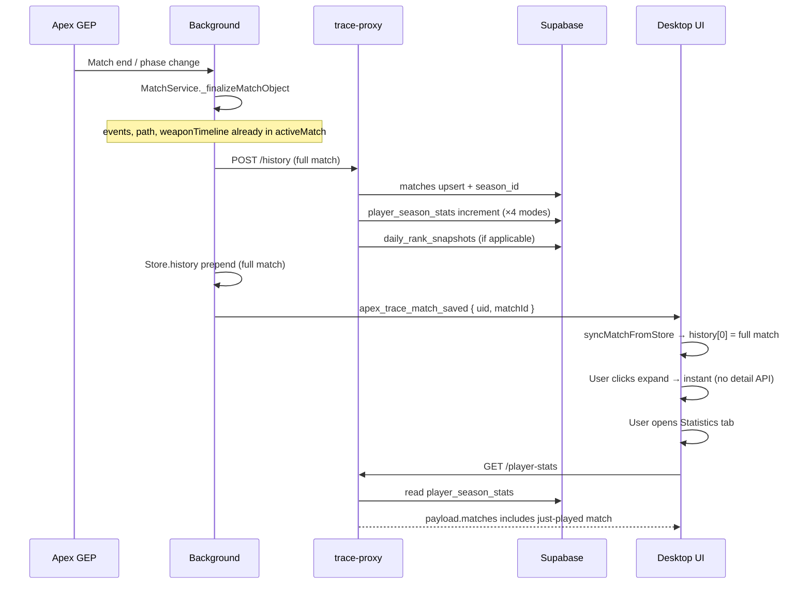
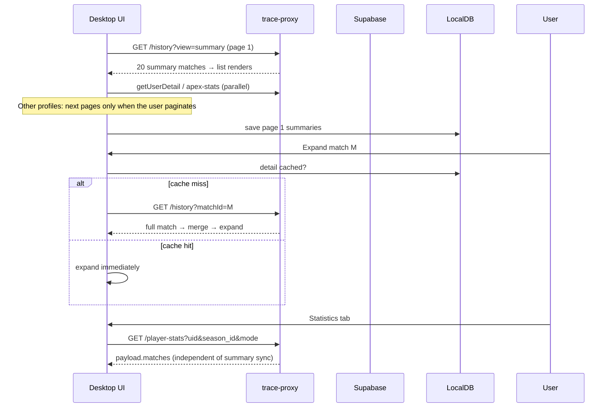

# 매치 데이터 아키텍처 V3

ApexTrace 매치 데이터·통계·클라이언트 로딩 전략.  
*(구 파일명: `match-data-architecture-v3.md`.)*

**상태:** Shipped. Supabase 마이그레이션 적용됨. 프로덕션 프록시: `trace-proxy-server.vercel.app`.  
**관련 코드:** `trace-proxy-server/lib/matchHistory.js` (`rowFromMatch` / `matchFromRow`), `api/history.js`, `api/address-book.js`, `src/App.tsx`, `src/components/StatisticsTab.tsx`, `src/utils/playerStatsApi.ts`, `src/utils/statsAggregation.ts`, `public/background/services/matchService.js`, `public/background/main.js` (`SyncManager`)

---

## 1. 목표

| 목표 | 설명 |
| --- | --- |
| 빠른 첫 페인트 | 수천 판이 있어도 다른 유저 프로필에서 매치 목록이 빨리 뜸 |
| 완전한 통계 | Statistics 탭이 대시보드 history 동기화를 기다리지 않고 `player-stats` 시즌 묶음으로 집계를 표시 |
| 완전한 매치 상세 | 펼치면 Combat Log·맵 경로·로드아웃 타임라인 사용 가능 |
| 서버가 SSOT | 시즌·매치·시즌 summary 묶음은 Supabase; 앱은 표시·라이브 캡처·지표 집계 셸 |
| v2 `matches`만 | `public.match_archives`(v1)는 읽기/쓰기 없음 |

---

## 2. 설계 원칙

### 2.1 클라이언트 역할 (“셸”)

Overwolf 확장이 담당:

- GEP 라이브 매치 캡처 (이벤트, path, 무기)
- 백그라운드 finalize·업로드 큐
- 활성 세션용 `Store.history`
- LocalDB(IndexedDB) 캐시 (오프라인·재방문)
- UI 렌더·네비게이션
- Statistics 집계: 대시보드 `history`가 아니라 `GET /player-stats`의 `payload.matches`를 클라이언트에서 집계 (`statsAggregation` / `weaponMatchStats`)

대시보드 목록 동기화와 Statistics는 **독립**. 시즌 통계를 위해 history 전체를 기다리지 않음.

### 2.2 서버 역할 (SSOT)

프록시 + Supabase가 담당:

- 시즌 정의 (단일 소스)
- 정규화 매치 행 (`public.matches`)
- 시즌/모드별 summary 매치 묶음 (`public.player_season_stats.payload.matches`)
- 일별 랭크 스냅샷 (기존, RP 차트용)

### 2.3 데이터 3단

```
┌─────────────────────────────────────────────────────────────────┐
│ Tier 1 — Summary     목록 카드, 사이드바 태그, 스탯 입력용     │
│                      (events / path 없음)                       │
├─────────────────────────────────────────────────────────────────┤
│ Tier 2 — Detail      events, path, weapon_timeline, ring_rounds │
│                      펼침(또는 prefetch) 시 매치별 로드          │
├─────────────────────────────────────────────────────────────────┤
│ Tier 3 — Season stats  uid/season/mode별 payload.matches JSONB  │
│                        Statistics가 받아 클라이언트 집계        │
└─────────────────────────────────────────────────────────────────┘
```

---

## 3. Supabase 스키마

### 3.1 `public.seasons` (SSOT)

시즌 경계는 **Supabase에만** 정의. 앱은 기존 config sync(`ConfigController` → `window.SEASONS`)로 읽음. `App.tsx`의 `FALLBACK_SEASONS`는 부트스트랩/오프라인용.

| 컬럼 | 타입 | 비고 |
| --- | --- | --- |
| `id` | `integer` PK | UI `selectedSeasonId`에 쓰는 단조 증가 id |
| `name` | `text` | 표시명 예: `Season 28 : Split 2` |
| `start_time` | `bigint` | epoch ms, inclusive |
| `end_time` | `bigint` nullable | epoch ms, exclusive; `null` = 진행 중 split |
| `version` | `integer` | 경계 변경 시 증가 → 클라이언트 캐시 무효화 |

**배정 규칙:** 매치 `start_time`(없으면 `end_time`)에 대해 `start_time >= seasons.start_time` 이고 (`end_time`이 null이거나 `start_time < seasons.end_time`)인 시즌을 찾음.

쓰기에 해석된 `season_id`를 매치 행에 저장 (§3.2).

### 3.2 `public.matches` (v2 확장)

기존 v2 컬럼 유지. 추가:

| 컬럼 | 타입 | 비고 |
| --- | --- | --- |
| `season_id` | `integer` nullable | INSERT/UPDATE 시 `public.seasons`에서 설정 |
| `player_name` | `text` nullable | 로컬 플레이어 닉 (deaths/weaponCombat 식별) |
| `missing_signals` | `jsonb` nullable | 불완전 배지 툴팁용 GEP 갭 목록 |

**Heavy 컬럼** (Tier 2 — summary API에서 제외):

- `events`
- `path`
- `weapon_timeline`
- `ring_rounds`

**Summary 컬럼** (Tier 1 — 목록/동기화 API 포함):

- 스칼라 스탯, `rank`, `loadout`, `weapon_combat`, `team_stats`, `teammate_kills`, `player_name`, `missing_signals`, 타임스탬프, mode, map, legend 등

PK는 `(uid, match_id)`.

연동 계정: `resolveRelatedUids()`로 읽기/쓰기 모두 `mainUid` 기준 (현행과 동일).

### 3.3 `public.player_season_stats`

Statistics 탭용 시즌 범위 summary 묶음. 사전집계 숫자 JSON이 아니라 **매치 summary 배열**.

| 컬럼 | 타입 | 비고 |
| --- | --- | --- |
| `uid` | `text` | 플레이어 uid (링크 해석 후 main uid) |
| `season_id` | `integer` | FK → `public.seasons.id` |
| `mode` | `text` | `ALL` \| `RANKED` \| `TRIO` \| `DUO` |
| `match_count` | `integer` | 해당 버킷 매치 수 |
| `payload` | `jsonb` | `{ matches: summaryMatch[] }` (§3.4) |
| `updated_at` | `timestamptz` | 마지막 increment / recompute |

**PK:** `(uid, season_id, mode)`

새 매치 1판 → 최대 **4행** increment: `ALL` + 큐 버킷(`RANKED` / `TRIO` / `DUO`).

### 3.4 Statistics `payload` shape

클라이언트가 읽는 형태 (`src/utils/playerStatsApi.ts`):

```json
{
  "matches": [ /* camelCase summary matches (Tier 1 + weaponCombat / weaponThreats) */ ]
}
```

- **상한:** 시즌/모드당 최근 **2000**판 (`scripts/seed-teammate-test-data.ts` recompute와 동일).
- 대시보드 `history`와 별도. events / path / ring_rounds는 없음.
- `StatisticsTab`은 `payload.matches`를 `statsHistory`로 정규화한 뒤 Maps / Legends / Weapons / Teammates / Overview를 **클라이언트 집계**.
- 예전 `overview` / `legends` / `weapons` / `maps` / `teammates` / `performance_series` nested payload는 **사용하지 않음**.

랭크 진행 차트는 기존 **`daily_rank_snapshots`**. 사이드바 최근 20판 등수 추이는 대시보드 `history` (`PerformanceTrend`).

### 3.5 모드 의미

Statistics 필터 4모드. `src/utils/matchMode.ts`의 `matchesStatisticsMode()`와 일치해야 함.

| `mode` 키 | 의미 |
| --- | --- |
| `ALL` | 지원 BR 계열: Ranked + Trio + Duo + unknown fallback (`BR`) |
| `RANKED` | 모드 문자열에 `ranked` 포함 |
| `TRIO` | Trio, 비랭크 |
| `DUO` | Duo, 비랭크 |

`ALL`(통계)은 대시보드 history 탭의 내부 키 `BR`과 **다름**. 대시보드 `BR`은 `matchesHistoryTab()` 기준이고, UI 라벨은 **ALL** (`statistics.modes.br`).

---

## 4. API 설계

베이스: `trace-proxy-server` (Vercel). HTTP 경계에서는 별도 표기 없으면 레거시 camelCase 매치 shape.

### 4.1 `GET /history`

| Query | 용도 |
| --- | --- |
| `uid` | 필수 |
| `view=summary` | 기본. Tier 1만 (events/path 없음) |
| `view=detail` | 내부 별칭; 단건은 `matchId` 사용 |
| `matchId` | 설정 시 **한 판** 전체 (Tier 1 + 2) |
| `matchIds` | 선택 배치 detail (콤마, 최대 ~5). **클라이언트 미사용** |
| `cursor` | 페이지네이션: 이전 페이지 가장 오래된 `start_time` |
| `startDate` / `endDate` | 범위 (epoch ms); `ROWS_PER_FETCH`(200) 한도 |

**Summary 목록 기본:**

- 페이지 크기: **20**
- 정렬: `start_time DESC`
- 소스: `public.matches`만

**응답:**

```json
{ "history": [ /* camelCase summary matches */ ], "view": "summary" }
```

HTTP GET은 짧은 엣지 캐시 (`Cache-Control: public, max-age=0, s-maxage=30`). 클라이언트는 LocalDB·라이브 `Store.history`와 merge하므로 방금 끝난 본인 판이 가려지지 않음.

### 4.2 `POST /history`

확장 쪽 진입점은 동일. Body:

```json
{ "uid": "...", "match": { /* finalize된 camelCase match */ } }
```

**서버 처리 순서:**

1. `resolveRelatedUids`로 `mainUid` 해석
2. `public.seasons` + `match.startTime`으로 `season_id` 해석
3. `rowFromMatch`로 정규화 컬럼만 upsert (`player_name`, `missing_signals` 포함). `_` 키·`isDead`/`startPos`/`endPos`는 저장하지 않음
4. `(mainUid, season_id, ALL|RANKED|TRIO|DUO)`에 대해 `player_season_stats.payload.matches` upsert (상한 2000)
5. 해당 시 `daily_rank_snapshots` upsert (기존 경로)

`match_archives`에는 **쓰지 않음**. `legacy_match` / `schema_version` / `dataQuality` / `confidence` 컬럼은 없음. 불완전 판정은 클라이언트가 `placement`·combat null로 하고, 배지 툴팁만 `missing_signals`를 씀.

### 4.2.1 `POST /address-book` (로스터)

GEP 로스터는 매치당 최대 ~60명. 트래픽 가드:

| 층 | 동작 |
| --- | --- |
| 클라이언트 `SyncManager` | 세션 중 이미 보낸 UID는 name/hw/linked_uid/platform이 같으면 스킵. 신규·변경분만 4초 debounce 후 전송. 매치 종료 시 flush |
| 클라이언트 `repository` | 20명씩 순차 POST. 프로필 로드는 fingerprint가 같으면 POST 생략 |
| 서버 | 기존 행과 comparable 필드가 같으면 upsert/`updated_at` 갱신 생략. 닉이 바뀐 UID만 alias sync (동시 5) |

### 4.3 `GET /player-stats`

| Query | 용도 |
| --- | --- |
| `uid` | 필수 |
| `season_id` | 필수 (integer) |
| `mode` | `ALL` \| `RANKED` \| `TRIO` \| `DUO`; 기본 `ALL` |

**응답:**

```json
{
  "uid": "...",
  "season_id": 3,
  "mode": "ALL",
  "match_count": 847,
  "updated_at": "2026-06-28T12:00:00Z",
  "payload": { /* §3.4 */ }
}
```

행이 없으면 404가 아니라 `match_count: 0`의 빈 payload.

### 4.4 `GET /seasons`

`public.seasons` 활성 목록 (앱 config sync가 기대하는 shape). 엣지 캐시 1시간 (`s-maxage=3600`). 장기적으로 하드코딩/config-json 시즌을 대체.

읽기 GET 캐시 요약: `history` 30s · `search-candidates` 60s · `apex-stats` 180s · `seasons` 1h. 클라이언트는 `t=Date.now()` 캐시 버스터를 붙이지 않음.

---

## 5. 클라이언트 로딩 전략

### 5.1 프로필 로드 (임의 플레이어)

```
1. fetchUserHistory(uid)           → summary 1페이지(20행) — 목록 ASAP
2. getUserDetail(uid)              → 프로필 + history promise 재사용 (이중 fetch 금지)
3. LocalDB: summary 행 저장
4. 본인 계정만: 나머지 summary를 백그라운드 페이지네이션 (목록 위 진행 오버레이)
5. 타인 프로필: 페이지를 넘길 때만 다음 summary 청크 lazy fetch
```

**Statistics 탭은 목록 sync를 기다리지 않음.** `GET /player-stats`를 독립 호출.

### 5.2 매치 펼침 (detail)

**패턴: fetch-then-expand** (탭이 항상 완전한 데이터로 열리게)

```
onPointerDown → prefetch(matchId) 시작     // non-blocking
onClick       → detail 캐시 있으면 즉시 expand
              → 없으면 GET /history?uid&matchId await → history merge → expand
```

**Prefetch 우선순위 (빠른 것부터):**

1. 메모리 `history`에 이미 `events` / `path` (라이브 매치 — §7)
2. LocalDB detail 캐시
3. 네트워크 `GET /history?matchId=`

보이는 페이지 **상위 3행**을 백그라운드 prefetch + pointerdown. `matchIds=` 배치 API는 미사용.

### 5.3 Statistics 탭

```
마운트 또는 시즌/모드 변경:
  GET /player-stats?uid=&season_id=&mode=
  → payload.matches → statsHistory
  → Overview/Maps/Legends/Weapons/Teammates 클라이언트 집계
```

대시보드 `history`로 시즌 통계를 만들지 않음. 매치 저장 후 `statsRefreshToken`으로 현재 시즌 stats 재요청.

### 5.4 오버레이

| 오버레이 | 시점 | 막는 것 |
| --- | --- | --- |
| Profile loading | ALS 스탯 + 첫 summary 페이지 | 스크롤 영역 전체 (패딩 포함) |
| History sync | **본인 계정** summary 페이지네이션 | 매치 목록 (진행 카운트 오버레이) |
| 타인 lazy page | 페이지 넘김 시 다음 청크 | 목록을 통째로 막지 않음 |
| Match row spinner | expand 전 detail fetch | 해당 행만 |
| Statistics | `player-stats` 로딩 중 | 통계 탭 본문 |

---

## 6. End-to-end 플로우

### 6.1 Flow A — 본인 매치 종료 후 확인

**라이브 경로.** Detail은 이미 메모리에 있음 → lazy fetch 없음.



**타임라인 (전형적):**

| 시각 | 이벤트 |
| --- | --- |
| T+0s | 인게임 매치 종료 |
| T+1–3s | POST 완료; 목록 최상단에 행 표시 |
| T+3s | 펼침 → 맵 / combat / loadout 즉시 |
| T+5s | Statistics → 서버 통계에 새 매치 포함 |

### 6.2 Flow B — 다른 플레이어 프로필



타인 프로필은 목록을 끝까지 백그라운드 받지 않음. 통계는 `player-stats`만으로 시즌 전체를 표시.

### 6.3 Flow C — 재방문 incremental sync

```
GET /history?startDate=(latestLocalTime+1)  → 새 summary만
GET /player-stats                           → updated_at 변경 시 갱신
LocalDB                                     → summary + detail 캐시 merge
```

---

## 7. 라이브 매치 예외

활성 세션에서 `Store.activeMatch`와 finalize prepend는 서버 왕복 전에 이미 **Tier 1 + Tier 2**.

| 출처 | Detail 가능 |
| --- | --- |
| 방금 finalize, 아직 `Store.history` | 예 — detail API 스킵 |
| 앱 재로드, summary-only API | 아니오 — lazy detail |
| 다른 기기 | 아니오 — lazy detail |

확장은 `POST /history`에 **full match**를 써서 이후 lazy load용 Tier 2가 Supabase에 있게 함.

---

## 8. 시즌 관리와 지연 반영

### 8.1 문제

`public.seasons`에 새 시즌 행이 **매치 저장 이후**에 추가되면:

- 해당 매치의 `season_id`가 틀리거나 null
- `player_season_stats`가 잘못된 버킷
- 클라이언트 시즌 라벨과 서버 집계가 sync 전까지 불일치

### 8.2 완화

| 수단 | 설명 |
| --- | --- |
| SSOT | 경계는 `public.seasons`만; 앱·서버 모두 읽음 |
| 매치에 `season_id` 저장 | 클라이언트 시즌 리스트로 재계산하지 않음 |
| `pending` 버킷 | 쓰기 시 매칭 시즌 없으면 `season_id = null`, 재배정 큐 |
| Backfill job | 시즌 변경 시 영향 `start_time` 범위 재배정 + `player_season_stats` 재계산 |
| `seasons.version` | 경계 수정 시 bump → 클라이언트가 seasons/stats 재요청 |

### 8.3 Backfill 절차 (운영)

1. `public.seasons` insert/update
2. `reassign_match_seasons(start_time_min, start_time_max)` RPC
3. 영향 uid 또는 전체 `recompute_player_season_stats(uid?)`
4. 샘플 유저로 `match_count` vs `matches`의 `COUNT(*)` 검증

---

## 9. 통계 계산

표시 지표(승률·K/D·Top Weapons 등)는 **클라이언트** (`statsAggregation.ts`, `weaponMatchStats.ts`). 서버 행은 시즌 범위 summary 배열만 유지.

### 9.1 `POST /history` 시 increment

저장 매치마다:

1. 적용 모드 결정 (항상 `ALL` + 지원 시 `RANKED`/`TRIO`/`DUO` 하나)
2. 각 `(uid, season_id, mode)` 행의 `payload.matches`에 해당 summary upsert, `match_count` 갱신 (상한 2000)

### 9.2 Full recompute

Backfill·드리프트 수정용 (시드 스크립트와 동일 패턴):

```
SELECT summary columns FROM matches WHERE uid = ? AND season range
→ payload = { matches: [...] } 로 교체
```

### 9.3 로직 동등성

서버는 집계 숫자를 만들지 않으므로 payload vs UI shadow 비교는 **해당 없음**. 무기 킬/데스 규칙은 클라이언트·background·프록시 `weaponCombat`이 같아야 함 ([WEAPON-STATS.md](./WEAPON-STATS.md)).

---

## 10. LocalDB 캐시

| 키 | 저장 |
| --- | --- |
| `(uid, matchId)` summary | Tier 1 |
| `(uid, matchId)` detail | Tier 2 또는 merge 객체에 `_detailLoaded: true` |
| Metadata | uid별 `summarySyncComplete`, `lastSummaryCursor` |

프로필 전환 시 generation 카운터로 in-flight sync 취소 (기존 `archiveSyncGenerationRef` 패턴).

---

## 11. Deprecations

| 항목 | 상태 |
| --- | --- |
| `public.match_archives` | Deprecated — v3에서 읽기/쓰기 없음 |
| 대시보드 `history`로 시즌 통계 집계 | Deprecated — `player-stats` `payload.matches`만 |
| nested `overview` / `performance_series` payload | Deprecated — `{ matches }`만 |
| `view=summary` 없이 full rows 반환하는 `GET /history` | Deprecated — 기본 summary |
| `matches.legacy_match` / `schema_version` | 제거됨 — 정규화 컬럼 + `missing_signals` |
| 권한원으로서의 `FALLBACK_SEASONS` | 부트스트랩만 |

---

## 12. 롤아웃 단계

### Phase A — API 분리 (stats 테이블 전)

- [x] `GET /history?view=summary` — heavy 컬럼 제외
- [x] `GET /history?matchId=` — 단건 detail
- [x] 클라이언트: lazy detail + fetch-then-expand
- [x] 클라이언트: summary 페이지네이션 오버레이
- [x] 프록시에서 `match_archives` 완전 제거 확인

### Phase B — Seasons SSOT

- [x] `public.seasons` 생성
- [x] config sync가 테이블 읽도록 마이그레이션
- [x] `matches` 쓰기에 `season_id` 추가
- [x] 기존 행 `season_id` backfill — 스킵 (프리런치)

### Phase C — 서버 통계

- [x] `public.player_season_stats` 생성
- [x] `GET /player-stats` 구현
- [x] `POST /history` 시 increment
- [x] 기존 매치 전체 backfill — 스킵 (프리런치)
- [x] StatisticsTab이 `payload.matches` 사용 (대시보드 history fallback 없음; 집계는 클라)

### Phase D — Polish

- [x] 보이는 행 + pointerdown detail prefetch
- [x] 매치 저장 후 `player-stats` prefetch (`statsRefreshToken`)
- [ ] Shadow stats parity 테스트 — 보류
- [x] 클라이언트 stats fallback 제거

---

## 13. 에러 처리

| 실패 | 클라이언트 | 서버 복구 |
| --- | --- | --- |
| POST /history 실패 | Store / pending 큐에 유지 | 백그라운드 재시도 |
| Summary 페이지 실패 | LocalDB 캐시 표시; cursor 재시도 | — |
| Detail fetch 실패 | 행 에러 상태; 재클릭 시 재시도 | — |
| player-stats 없음 | 빈 통계 + “no data” | Backfill job |
| Season 오배정 | backfill 전까지 시즌 필터 어긋날 수 있음 | §8.3 backfill |

---

## 14. 보안·프라이버시

- 매치 행은 공개 Apex `uid` 키 (기존 모델)
- `matches`, `player_season_stats`, `seasons` RLS는 uid 읽기 허용 (현 프록시 service role 패턴과 동일)
- `_saved`, `startPos`, `endPos` 등 런타임 전용 키는 API 응답에 노출하지 않음

---

## 15. 결정된 로딩 정책 (구 미결)

1. **Summary sync 오버레이:** 본인 계정은 목록 위 진행 오버레이. 타인 프로필은 페이지 lazy fetch, 대시보드 전체를 막지 않음.
2. **시즌 포인트 상한:** `performance_series` 없음. `payload.matches` 최근 2000. Overview는 이 배열 집계, 사이드바 등수 스파크라인은 대시보드 history 최근 20.
3. **배치 detail:** `matchIds=` 미사용. 단건 prefetch (보이는 페이지 상위 3 + pointerdown).
4. **Weapons 탭:** `payload.matches`의 `weaponCombat` / `weaponThreats`로 충분. 펼침용 events/path는 불필요.

---

## 16. 빠른 참조

| 사용자 행동 | 데이터 소스 |
| --- | --- |
| 매치 목록 카드 | Summary `GET /history` (+ LocalDB) |
| 펼침 (방금 플레이한 라이브) | `Store.history` full object |
| 펼침 (그 외) | `GET /history?matchId=` 또는 캐시 |
| Statistics 탭 | `GET /player-stats` → `payload.matches` 클라 집계 |
| 사이드바 최근 20 등수 | 대시보드 `history` (`PerformanceTrend`) |
| 랭크 진행 차트 | `daily_rank_snapshots` (기존) |
| 시즌 셀렉터 라벨 | config sync의 `public.seasons` |
| 게임 후 새 매치 | `POST /history` → matches + stats increment |

---

*최종 갱신: 2026-09-11 · 한국어화: 2026-08-01*
