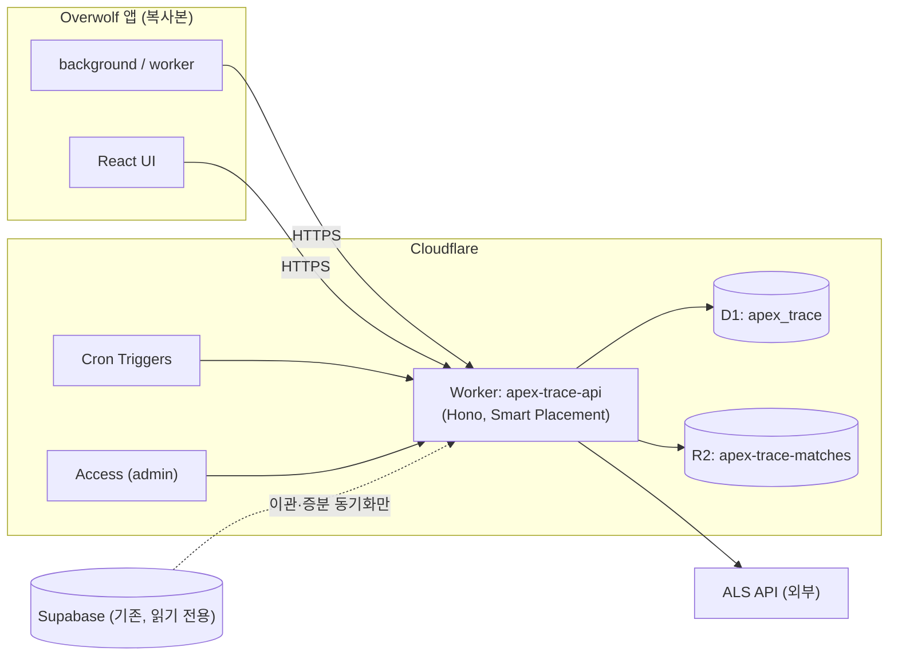

# Cloudflare 이전 계획 (Workers + D1 + R2)

**상태:** 계획 (미구현). 실행은 별도 세션에서 Phase 순서대로 진행한다.
**작성:** 2026-11-28
**범위:** 이 저장소(`apex-trace - 복사본`, `update` 브랜치)만 새 백엔드에 연결한다. QA에 제출된 빌드(Vercel `trace-proxy-server` + Supabase)는 **그대로 둔다**.
**관련 문서:** [ARCHITECTURE.md](./ARCHITECTURE.md) (현 API·데이터 3단), [DB-OPTIMIZATION.md](./DB-OPTIMIZATION.md) (스키마 문제점·개선안. 이 문서는 그 개선안을 D1/R2 위에서 한 번에 적용한다), [NICKNAME-SEARCH.md](./NICKNAME-SEARCH.md), [WEAPON-STATS.md](./WEAPON-STATS.md)

---

## 0. 요약

| 항목 | 현재 | 이전 후 |
|------|------|---------|
| API | Vercel `trace-proxy-server.vercel.app/api` (Node) | Cloudflare Workers, 커스텀 도메인 (예: `api.<도메인>`) |
| DB | Supabase Postgres (`ureuzkxyyozzzluzawwr`, 서울) | Cloudflare D1 (SQLite) |
| 매치 상세 (events/path/ring/weapon timeline) | `matches` JSONB 컬럼 | R2 객체 (`matches/{uid}/{matchId}.json`) |
| 시즌 통계 (Tier 3) | `player_season_stats.payload` (매치 summary 복사본) | **테이블 삭제**. `matches`를 매번 조회 |
| 관리자 인증 | Supabase Auth + `admin_users` | Cloudflare Access (이메일 정책) |
| 클라이언트 직접 DB 조회 | anon key로 `languages`/`weapons`/`seasons`/`daily_rank_snapshots`/`player_season_stats` 직접 읽음 | 전부 Worker API로. 클라이언트에서 Supabase SDK 제거 |
| 정기 작업 | Vercel cron (keep-alive, 하루 1회) | Workers Cron Triggers |

**이전 이유:** Vercel Hobby는 비상업용 전용이라 수익화하면 Pro가 필요하다. Supabase 무료 슬롯이 부족하다. 스키마 개편([DB-OPTIMIZATION.md](./DB-OPTIMIZATION.md) Phase 0–4)을 기존 운영 DB를 건드리지 않고 새 저장소에서 한 번에 적용할 수 있다.

**원칙:**
1. **기존 Supabase·Vercel에는 쓰지 않는다.** 이관 스크립트는 Supabase를 **읽기만** 한다. 이 원칙은 QA 제출본이 계속 동작하는 전제다.
2. **HTTP 응답 shape는 유지한다.** 레거시 camelCase 매치 shape와 `{ payload: { matches } }` 형태를 그대로 둬서 클라이언트 변경을 base URL 교체와 직접 조회 제거로 한정한다.
3. 플랫폼 이전과 스키마 개편을 동시에 하므로, **Phase 6 parity 검증(같은 uid·시즌에서 옛 API와 새 API 결과 비교)을 통과해야 출시한다.**

---

## 1. 현황 (2026-11-28 실측)

### 1.1 테이블

| 테이블 | 행 | 크기 | 비고 |
|--------|----|------|------|
| `global_profiles` | 73,708 | 17 MB | 마이그레이션 파일 없음 (대시보드에서 생성) |
| `matches` | 1,712 | 14 MB | uid 7명. 매치당 약 8 KB |
| `player_season_stats` | 40 | 1.6 MB | payload 평균 24 KB, 최대 134 KB (압축 후). 매치 summary를 복사해 둔 것 |
| `languages` | 10 | 520 kB | `strings` JSONB |
| `profile_name_aliases` | 895 | 512 kB | |
| `player_account_stats` | 3 | 384 kB | |
| `weapons` | 38 | 112 kB | `text[]` 컬럼 5개 |
| `daily_rank_snapshots` | 202 | 96 kB | |
| `seasons`, `game_constants`, `admin_users` | 소량 | | |

DB 전체 82 MB.

### 1.2 `matches` 컬럼별 평균 크기 (압축 후 바이트)

| `path` | `events` | `weapon_timeline` | `weapon_combat` | `ring_rounds` | `team_stats` | `rank` | `loadout` | `teammate_kills` |
|---|---|---|---|---|---|---|---|---|
| 2,475 | 449 | 293 | 293 | 251 | 203 | 71 | 50 | 30 |

Tier 2 detail 컬럼(`path`·`events`·`weapon_timeline`·`ring_rounds`)이 압축 후 기준 약 75%를 차지한다. 이 컬럼들을 R2로 빼면 D1에는 매치당 약 1.5 KB만 남는다.

### 1.3 Postgres 전용 기능 사용처

| 기능 | 사용처 | D1 대응 |
|------|--------|---------|
| `jsonb` | 19곳 | `TEXT` JSON + `json_extract` / `->>` |
| `text[]` | `weapons` 5컬럼 | `TEXT` JSON 배열 |
| RLS 정책 8개 | 전부 public `SELECT` | 불필요. 모든 접근은 Worker를 거친다 |
| 트리거 `set_matches_updated_at` | `matches` | 쓰기 코드에서 `updated_at` 설정 (트리거 안 씀) |
| 함수 `upsert_language_pack` | `scripts/seed-languages.ts` | admin API `PUT /admin/languages/:lang`로 대체 |
| `timestamptz` | 다수 | `INTEGER` epoch ms (`start_time`과 단위 통일) |

### 1.4 API 사용 지점 (이 저장소)

**프록시 엔드포인트** (base: `PROXY_BASE_URL`, 하드코딩 4곳: `public/background/config.js:2`, `public/background/repository.js:3`, `public/background/services/apiService.js:1`, `src/utils/playerStatsApi.ts:33`):

| 메서드 | 경로 | 호출처 |
|--------|------|--------|
| GET | `/history?uid&view=summary&cursor` · `?matchId` · `?startDate&endDate` | `apiService.js`, `repository.js`, `src/web/api.ts` |
| POST | `/history` | `repository.js:168` |
| GET/POST | `/address-book` | `repository.js:71,97,126` |
| GET | `/player-stats?uid&season_id&mode` | `apiService.js:106`, `playerStatsApi.ts:54` |
| GET | `/seasons` | `apiService.js:123` |
| GET | `/search-candidates?query` | `repository.js:53`, `src/web/api.ts:46` |
| GET | `/apex-stats?query&type` | `apiService.js:28`, `src/web/api.ts:55` |
| POST | `/rank-snapshots` | `repository.js:211` |
| GET/POST | `/account-stats` | `repository.js:234,250` |
| * | `/admin/{profiles,matches,seasons,weapons,languages}` | `admin/src/pages/*.tsx` (Supabase 세션 토큰) |
| cron | keep-alive (ALS 갱신 12명/일, alias TTL purge) | Vercel cron |

**Supabase 직접 조회** (anon key, `src/lib/supabase.ts`) — 전부 Worker API로 바꿔야 한다:

| 파일 | 테이블 | 대체 API |
|------|--------|---------|
| `src/lib/loadLanguages.ts:34,60` | `languages` (version 확인, strings) | `GET /languages`, `GET /languages/:lang` |
| `src/utils/WeaponsData.ts:109` | `weapons` | `GET /weapons` |
| `src/utils/rankSnapshots.ts:61` | `daily_rank_snapshots` | `GET /rank-snapshots?uid&from&to` |
| `src/utils/seasonAvailability.ts:14` | `player_season_stats` (시즌별 데이터 유무) | `GET /player-seasons?uid` → `{ seasonIds: number[] }` |
| `src/web/api.ts:72` | `seasons` | `GET /seasons` |
| `public/background/main.js:801,815` | `seasons`, `game_constants` | 현재 `window._supabase = null`이라 죽은 코드. `GET /seasons` + `GET /game-constants`로 되살리거나 삭제 |
| `admin/src/App.tsx`, `Login.tsx`, `lib/api.ts` | Supabase Auth | Cloudflare Access (§5) |
| `scripts/seed-*.ts`, `build-demo-matches.mjs`, `game-icons/sync_supabase.py` | 다수 | admin API 또는 `wrangler d1 execute` (§7.3) |

**Overwolf manifest:** `manifest.json:104-112` `externally_connectable.matches`에 Supabase·Vercel 도메인이 있다. 새 API 도메인을 추가해야 하고, Supabase 도메인은 직접 조회를 다 없앤 뒤 제거한다.

### 1.5 프록시 소스 (2026-11-28 검토)

위치: 이 저장소 안 `trace-proxy-server/` (별도 git 저장소, 이 저장소의 `.gitignore`에 포함). 최신 커밋 `d5db544`. Node(ESM) + `@supabase/supabase-js`, 코드 약 2,700줄. 환경 변수는 `SUPABASE_URL`, `SUPABASE_SERVICE_KEY`, `SUPABASE_ANON_KEY`(admin 폴백), `MOZAMBIQUE_API_KEY`(ALS).

| 파일 | 줄 | 이식 시 메모 |
|------|----|-------------|
| `lib/matchHistory.js` | 234 | `rowFromMatch`/`matchFromRow`/`SUMMARY_SELECT`. 정수 컬럼 `Math.round`, `_`·`isDead`/`startPos`/`endPos` 제거. 그대로 이식 |
| `lib/weaponCombat.js` | 343 | 클라이언트 `src/utils/weaponMatchStats.ts`(`computeMatchWeaponCombat`·`computeMatchWeaponThreats`)와 **같은 로직의 JS 사본**. Worker는 사본을 만들지 말고 `src/utils/weaponMatchStats.ts`를 직접 import해서 한 곳만 유지한다 |
| `lib/matchModes.js` | 37 | `includes()` 기반 버킷. `BR`(모드 불명 폴백)은 `ALL`에만 들어감. TRIO/DUO는 ranked 제외 |
| `lib/profiles.js` | 16 | `resolveRelatedUids` → `{ mainUid, allUids, role }`. **읽기는 `allUids` 전체**(`.in('uid', allUids)`), 쓰기는 `mainUid` |
| `lib/seasons.js` | 47 | 60초 메모리 캐시, `resolveSeasonId` |
| `lib/accountStats.js` | 250 | GEP `player_stats` 스냅샷 저장 + **RP 고정 로직**: `br_ranked_latest` 두 스냅샷이 정확히 1판 차이이고 같은 split이면 `rp_change`를 계산해 해당 랭크 매치(`rp_processed = false`, `end_time >= minEnd`, `start_time <= at`)에 기록. 매치가 아직 없으면 `pending_rp`에 보관했다가 `POST /history`에서 적용 |
| `lib/playerStats.js` | 257 | `player_season_stats` increment·GET 중 backfill. **이식하지 않음** (§3.9) |
| `lib/nameAliases.js` | 225 | `normalizeName` = JS `trim().toLowerCase()`(유니코드). alias 최대 3개, TTL 30일, corrupt name(제어문자) 차단 |
| `lib/adminAuth.js` | 64 | Supabase JWT + `admin_users`. Access로 대체 (§5) |
| `api/history.js` | 148 | GET summary/detail/range, POST upsert. RP 컬럼은 `rp_processed`가 true일 때만 덮어씀 (클라이언트 재업로드가 서버가 채운 RP를 지우지 않게) |
| `api/address-book.js` | 166 | GET uid/name, POST 변경분만 upsert + alias sync |
| `api/apex-stats.js` | 184 | ALS bridge + DB 캐시. **캐시 적중 시 snake_case DB 행, ALS 응답 시 camelCase 객체**를 돌려준다. 클라이언트가 두 shape를 다 처리하므로 그대로 유지 |
| `api/account-stats.js` | 58 | GET/POST. POST는 `text/plain` 본문(CORS preflight 회피) |
| `api/rank-snapshots.js` | 90 | POST upsert, **GET `?uid&limit`(기본 60, 최대 365) 이미 있음** |
| `api/keep-alive.js` | 97 | `als_synced_at` 오래된 순 12명, 5초 간격. Hobby라 하루 1회만 실행 중 |
| `api/admin/[...path].js` | 297 | profiles/matches/weapons/seasons/languages CRUD, 모든 쓰기에 `confirm: true` 요구 |
| `api/seasons.js`, `search-candidates.js`, `player-stats.js` | 73 | |

`git status`에서 `lib/weaponCombat.js`가 수정됨으로 나오지만 `git diff` 내용은 비어 있다 (줄바꿈 차이로 보임). 실제 변경은 없다.

---

## 2. 목표 아키텍처



| 구성 | 결정 |
|------|------|
| Worker | 하나 (`apex-trace-api`). 라우터는 Hono. TypeScript. `compatibility_flags = ["nodejs_compat"]` |
| 도메인 | `api.<도메인>` 커스텀 도메인 (Workers Custom Domain). 클라이언트는 이 주소만 안다. 이후 호스팅을 바꿔도 클라이언트 업데이트가 필요 없다 |
| 배치 | D1 생성 시 location hint `apac`, Worker는 Smart Placement (`placement = { mode = "smart" }`) |
| 캐시 | 응답 `Cache-Control` + Workers Cache API. 정적에 가까운 데이터(`seasons`·`languages`·`weapons`·`game-constants`)는 길게, `history`는 30초, R2 detail은 immutable |
| 시크릿 | `wrangler secret put`: `ALS_API_KEY`, 이관용 `SUPABASE_URL` / `SUPABASE_SERVICE_ROLE_KEY` (Phase 7 증분 동기화가 끝나면 삭제) |
| 플랜 | **Workers Paid($5/월)부터 시작.** 무료 플랜의 CPU 10 ms는 `/player-stats`(최대 2,000행 JSON 변환)에 부족할 가능성이 높다 |

### 2.1 한도 (실행 전 공식 문서에서 다시 확인)

아래 수치는 작성 시점 기억 기준이다. Phase 1 시작 전 Cloudflare 문서로 확인하고 이 표를 고친다.

| 항목 | Free | Paid | 이 앱에 미치는 영향 |
|------|------|------|-------------------|
| D1 DB 크기 | 500 MB | 10 GB | detail을 R2로 빼면 매치당 약 1.5 KB → Paid에서 수백만 판 |
| D1 읽은 행 | 500만/일 | 250억/월 | `/player-stats` 1회 = 최대 2,000행 + 인덱스. **가장 큰 과금 요인** → §4.3 캐시 필수 |
| D1 쓴 행 | 10만/일 | 5,000만/월 | 매치 1판 = matches 1행 + 인덱스 + profile 갱신 ≈ 10행 |
| D1 쿼리당 바인딩 파라미터 | 100 | 100 | address-book 20명 다중 insert 불가 → `db.batch()`로 행별 statement |
| D1 행/값 최대 | 2 MB | 2 MB | `languages.strings` 확인 필요 (현재 행당 수십 KB로 추정) |
| R2 저장 | 10 GB | 종량 | 매치 detail gzip 약 3–5 KB |
| R2 egress | 무료 | 무료 | |
| Workers CPU | 10 ms | 기본 30 s | |

---

## 3. D1 스키마

공통 규칙:
- 시각은 전부 `INTEGER` epoch ms. 컬럼 이름은 `*_at` / `*_time` 유지.
- JSON은 `TEXT`. 쓰기 전에 Worker에서 `JSON.stringify`, 읽은 뒤 `JSON.parse`. SQL에서 JSON 내부를 조건으로 쓰지 않는다.
- `mode`·`map` 값은 쓰기 시점에 정규화한다 ([DB-OPTIMIZATION §5.2](./DB-OPTIMIZATION.md)). 매핑 테이블은 Worker `lib/normalize.ts` 하나에 둔다.
- 마이그레이션은 `wrangler d1 migrations create/apply` (`worker/migrations/NNNN_*.sql`). 원격 적용은 반드시 로컬 `--local` 리허설 후에 한다.

### 3.1 `seasons`

```sql
CREATE TABLE seasons (
  id          INTEGER PRIMARY KEY,
  name        TEXT    NOT NULL,
  start_time  INTEGER NOT NULL,
  end_time    INTEGER,              -- NULL = 진행 중
  version     INTEGER NOT NULL DEFAULT 1,
  created_at  INTEGER NOT NULL,
  updated_at  INTEGER NOT NULL
);
```

인덱스 없음 (행 수십 개, 미사용 인덱스 정리 [DB-OPTIMIZATION §6](./DB-OPTIMIZATION.md)).

### 3.2 `profiles` (구 `global_profiles`)

```sql
CREATE TABLE profiles (
  uid              TEXT PRIMARY KEY,
  name             TEXT NOT NULL,
  name_norm        TEXT NOT NULL,          -- Worker가 normalizeName(name)으로 계산해 같이 씀
  hw               INTEGER,                -- platform 대체 ([DB-OPTIMIZATION §3.4])
  level            INTEGER NOT NULL DEFAULT 0,
  prestige         INTEGER NOT NULL DEFAULT 0,
  current_xp       INTEGER,
  needed_xp        INTEGER,
  total_xp         INTEGER,
  rank_score       INTEGER NOT NULL DEFAULT 0,
  rank_name        TEXT    NOT NULL DEFAULT 'Unranked',
  rank_div         INTEGER NOT NULL DEFAULT 0,
  legend           TEXT,
  avatar           TEXT,
  linked_uid       TEXT,
  role             TEXT,
  refresh_priority INTEGER NOT NULL DEFAULT 0,  -- 0 로스터만 / 1 검색·조회됨 / 2 앱 사용자
  gep_synced_at    INTEGER,
  als_synced_at    INTEGER,
  last_seen_at     INTEGER,                -- GEP 로스터 관측 시각 (구 updated_at의 실제 의미)
  created_at       INTEGER NOT NULL,
  updated_at       INTEGER NOT NULL
);
CREATE INDEX profiles_name_norm_rank_idx ON profiles (name_norm, rank_score DESC);
CREATE INDEX profiles_linked_uid_idx     ON profiles (linked_uid) WHERE linked_uid IS NOT NULL;
CREATE INDEX profiles_refresh_idx        ON profiles (refresh_priority DESC, als_synced_at);
```

- 닉네임 검색은 `WHERE name_norm = ? ORDER BY rank_score DESC LIMIT 30`. `ILIKE` 이스케이프 로직은 버린다.
- **`name_norm`은 generated column으로 만들지 않는다.** 현행 `normalizeName()`은 JS `trim().toLowerCase()`라 유니코드 공백·대소문자를 처리하고, 현행 검색 `ILIKE`도 유니코드 대소문자를 무시한다. SQLite `lower()`/`trim()`은 ASCII만 처리하므로 결과가 달라진다. 그래서 Worker가 `normalizeName()`(`nameAliases.js`와 같은 함수)으로 계산해 `name`과 함께 쓴다. `profile_name_aliases.name_norm`도 같은 함수를 쓴다.
- `platform` 컬럼은 버린다. 이관 시 `hw`가 비어 있고 `platform`만 있는 행은 매핑해서 `hw`를 채운다.
- `SQLite` 정렬에서 NULL은 오름차순 맨 앞이라 `als_synced_at` 오름차순만으로 "nulls first"가 된다.

### 3.3 `profile_name_aliases`

```sql
CREATE TABLE profile_name_aliases (
  uid       TEXT NOT NULL,
  name_norm TEXT NOT NULL,
  name_raw  TEXT NOT NULL,
  source    TEXT NOT NULL DEFAULT 'unknown',
  seen_at   INTEGER NOT NULL,
  PRIMARY KEY (uid, name_norm)
) WITHOUT ROWID;
CREATE INDEX profile_name_aliases_name_norm_idx ON profile_name_aliases (name_norm);
CREATE INDEX profile_name_aliases_seen_at_idx   ON profile_name_aliases (seen_at);
```

TTL purge(30일)는 Cron에서 `DELETE ... WHERE seen_at < ?`.

### 3.4 `matches` (summary만)

```sql
CREATE TABLE matches (
  uid             TEXT    NOT NULL,      -- mainUid
  match_id        TEXT    NOT NULL,
  season_id       INTEGER,
  start_time      INTEGER NOT NULL,
  end_time        INTEGER,
  mode            TEXT,                  -- 정규화된 값
  stats_mode      TEXT GENERATED ALWAYS AS (
                    CASE
                      WHEN mode = 'Ranked' THEN 'RANKED'
                      WHEN mode = 'Trio'   THEN 'TRIO'
                      WHEN mode = 'Duo'    THEN 'DUO'
                      WHEN mode = 'BR'     THEN 'OTHER'
                      ELSE NULL
                    END) STORED,
  map             TEXT,
  legend          TEXT,
  player_name     TEXT,
  placement       INTEGER,
  kills           INTEGER,
  assists         INTEGER,
  knocks          INTEGER,
  damage          INTEGER,
  deaths          INTEGER,
  damage_hits     INTEGER,
  grenade_damage  INTEGER,
  squad_kills     INTEGER NOT NULL DEFAULT 0,
  ultimates_used  INTEGER NOT NULL DEFAULT 0,
  headshots       INTEGER NOT NULL DEFAULT 0,
  rp_change       INTEGER,
  rank_score      INTEGER,               -- 매치 후 RP (GEP 스냅샷에서 서버가 채움)
  rp_processed    INTEGER NOT NULL DEFAULT 0,
  rank_json            TEXT NOT NULL DEFAULT '{}',
  loadout_json         TEXT NOT NULL DEFAULT '{}',
  team_stats_json      TEXT NOT NULL DEFAULT '[]',
  teammate_kills_json  TEXT NOT NULL DEFAULT '{}',
  weapon_combat_json   TEXT NOT NULL DEFAULT '{}',
  weapon_threats_json  TEXT,             -- 쓰기 시 계산 ([DB-OPTIMIZATION §4.2.1])
  missing_signals_json TEXT,
  detail_version  INTEGER,               -- NULL = R2 detail 없음. 값 = R2 키 버전
  detail_bytes    INTEGER,
  created_at      INTEGER NOT NULL,
  updated_at      INTEGER NOT NULL,
  PRIMARY KEY (uid, match_id)
) WITHOUT ROWID;
CREATE INDEX matches_uid_start_idx ON matches (uid, start_time DESC);
CREATE INDEX matches_uid_season_stats_idx
  ON matches (uid, season_id, stats_mode, start_time DESC)
  WHERE stats_mode IS NOT NULL;
CREATE INDEX matches_rp_pending_idx            -- RP 고정 대상 찾기 (accountStats.findRankedMatchFor)
  ON matches (uid, start_time DESC)
  WHERE stats_mode = 'RANKED' AND rp_processed = 0;
```

- `stats_mode` 규칙은 `matchModes.js getStatisticsModeBuckets()` · 클라이언트 `matchMode.ts`와 같아야 한다. mode를 정규화하므로 `LIKE` 없이 등호로 충분하다. **정규화 표에 없는 새 모드가 들어오면 `stats_mode`가 NULL이 되어 통계에서 빠진다.** 이것은 현행 `isSupportedMode()`와 같은 동작이다.
- `rank_score`·`rp_change`·`rp_processed`는 **유지한다.** [DB-OPTIMIZATION §5.4](./DB-OPTIMIZATION.md)에서는 미사용 후보였지만, 그 뒤 프록시에 GEP 스냅샷 기반 RP 고정 로직(`lib/accountStats.js`)이 들어가서 세 컬럼 모두 쓰인다. 현행 `ilike('mode', '%ranked%')` 조건은 `stats_mode = 'RANKED'`로 바꾼다.
- `POST /history`의 RP 보존 규칙도 그대로 옮긴다: 업로드된 매치의 `rpProcessed`가 false면 upsert에서 `rank_score`·`rp_change`·`rp_processed`를 빼서 서버가 채운 값을 지키지 않게 한다.
- `matches_uid_legend_start_time_desc_idx`는 프록시·admin에서 사용처를 찾은 경우에만 다시 만든다.
- 쓰기 `uid`는 항상 `mainUid`다. **읽기(`GET /history`, RP 매치 찾기)는 현행처럼 `uid IN (mainUid, linkedUid)`로 조회한다.** 연동 전에 linked uid로 저장된 매치가 있을 수 있기 때문이다. 이관 시 linked uid 행을 `mainUid`로 합칠지는 §9 Q9.

### 3.5 R2 매치 detail

| 항목 | 결정 |
|------|------|
| 버킷 | `apex-trace-matches` (비공개. Worker 바인딩으로만 접근) |
| 키 | `matches/{uid}/{matchId}.v{detail_version}.json` |
| 본문 | `{ "events": [...], "path": <v2>, "ringRounds": [...], "weaponTimeline": [...] }` |
| 압축 | `CompressionStream('gzip')`으로 저장하고 `contentEncoding: 'gzip'` 메타데이터를 둔다. 응답 시 그대로 전달 |
| `path` 포맷 | v2 (`{v:2,t0,dt,x,y,p,s}`, [DB-OPTIMIZATION §5.3](./DB-OPTIMIZATION.md)). 이 복사본 클라이언트는 새로 배포되므로 처음부터 v2로 쓴다. 클라이언트 `matchNormalizer`에 `decodePath()`를 추가하고 v1 배열도 계속 읽는다 |
| 버전 | admin이 detail을 고치면 `detail_version + 1`로 새 키에 쓰고 옛 키는 삭제한다. 키가 바뀌므로 캐시 무효화가 필요 없다 (immutable 캐시) |

**쓰기 순서:** R2 `put` 성공 → D1 upsert(`detail_version` 설정). D1 행이 없는 R2 객체(고아)는 허용하고, D1이 가리키는데 R2에 없는 상태는 만들지 않는다. 고아 정리는 월 1회 Cron으로 충분하다.

### 3.6 `daily_rank_snapshots`

```sql
CREATE TABLE daily_rank_snapshots (
  uid           TEXT    NOT NULL,
  snapshot_date TEXT    NOT NULL,        -- 'YYYY-MM-DD' (현 date 타입과 같은 의미)
  rank_score    INTEGER NOT NULL DEFAULT 0,
  rank_name     TEXT,
  level         INTEGER,
  prestige      INTEGER,
  legend        TEXT,
  source        TEXT    NOT NULL DEFAULT 'als',
  updated_at    INTEGER NOT NULL,
  PRIMARY KEY (uid, snapshot_date)
) WITHOUT ROWID;
```

PK가 `(uid, snapshot_date)` 순이므로 `uid` 범위 조회용 별도 인덱스는 필요 없다.

### 3.7 `player_account_stats`

현 구조 유지. JSONB 컬럼(`career`, `br_ranked_latest`, `br_unranked_latest`, `br_ranked_history`, `br_unranked_history`, `pending_rp`)은 `*_json TEXT`, 시각은 `INTEGER`. PK `uid`.

### 3.8 메타데이터

```sql
CREATE TABLE languages (
  lang         TEXT PRIMARY KEY,
  display_name TEXT NOT NULL,
  strings_json TEXT NOT NULL DEFAULT '{}',
  version      INTEGER NOT NULL DEFAULT 1,
  is_active    INTEGER NOT NULL DEFAULT 1,
  is_default   INTEGER NOT NULL DEFAULT 0,
  updated_at   INTEGER NOT NULL
);

CREATE TABLE weapons (
  id               TEXT PRIMARY KEY,
  base_id          TEXT,
  variant          TEXT NOT NULL DEFAULT 'STANDARD',
  category         TEXT NOT NULL,
  fire_modes_json  TEXT NOT NULL DEFAULT '[]',
  ammo_types_json  TEXT NOT NULL DEFAULT '[]',
  attachments_json TEXT NOT NULL DEFAULT '[]',
  hopup_json       TEXT,
  care_hopup_json  TEXT,
  hopup_point      INTEGER,
  image_url        TEXT NOT NULL DEFAULT '',
  stats_json       TEXT NOT NULL DEFAULT '{}',
  name_key         TEXT NOT NULL,
  desc_key         TEXT NOT NULL,
  schema_version   INTEGER NOT NULL DEFAULT 1,
  is_active        INTEGER NOT NULL DEFAULT 1,
  sort_order       INTEGER NOT NULL DEFAULT 0,
  updated_at       INTEGER NOT NULL
);

CREATE TABLE game_constants (
  key        TEXT PRIMARY KEY,
  value_json TEXT NOT NULL,
  updated_at INTEGER NOT NULL
);
```

- **locale 규칙:** `languages.strings`는 키 추가만 허용한다 (기존 키 수정·삭제 금지, [CHANGE-ROUTINE.md](./CHANGE-ROUTINE.md)). 이관은 값을 그대로 복사하고 변환하지 않는다.
- 이관 전에 `max(length(strings::text))`를 측정해 D1 값 한도(2 MB) 안인지 확인한다.

### 3.9 삭제하는 테이블

| 테이블 | 이유 |
|--------|------|
| `player_season_stats` | [DB-OPTIMIZATION §4](./DB-OPTIMIZATION.md): 쓰기 증폭, lost update, 원본 불일치. `/player-stats`는 `matches`에서 조회 |
| `admin_users` | Cloudflare Access 정책으로 대체 |
| `match_archives` | 이미 deprecated |

---

## 4. Worker API

### 4.1 엔드포인트 (응답 shape는 현행 유지)

| 메서드 | 경로 | D1/R2 동작 | 캐시 |
|--------|------|-----------|------|
| GET | `/history?uid&view=summary&cursor` | `matches` summary 20행 (`start_time < cursor`) | `s-maxage=30` |
| GET | `/history?uid&matchId` | summary 1행 + R2 detail 병합 | detail은 R2 키 기준 immutable, 응답은 `s-maxage=30` |
| GET | `/history?uid&startDate&endDate` | 범위 summary, 200행 한도 | `s-maxage=30` |
| POST | `/history` | §4.2 | — |
| GET/POST | `/address-book` | `profiles` upsert (`db.batch`, 변경분만), alias sync | — |
| GET | `/player-stats?uid&season_id&mode` | §4.3 | §4.3 |
| GET | `/player-seasons?uid` (**신규**) | `SELECT DISTINCT season_id FROM matches WHERE uid=? AND stats_mode IS NOT NULL` | `s-maxage=60` |
| GET | `/seasons` | `seasons` 전체 | `s-maxage=3600` |
| GET | `/search-candidates?query` | `profiles.name_norm` exact + alias | `s-maxage=60` |
| GET | `/apex-stats?query&type` | `als_synced_at` 캐시 후 ALS 호출 | `s-maxage=180` |
| GET | `/rank-snapshots?uid&limit` (현행 있음, 기본 60·최대 365) | `daily_rank_snapshots` 최신순. 클라이언트 `rankSnapshots.ts`의 직접 조회를 이것으로 바꾼다 | `s-maxage=60` |
| POST | `/rank-snapshots` | upsert | — |
| GET/POST | `/account-stats` | `player_account_stats` | — |
| GET | `/languages` (**신규**) | `lang, display_name, version, is_default` (활성만) | `s-maxage=300` |
| GET | `/languages/:lang` (**신규**) | `strings_json` | `s-maxage=3600`, 클라이언트가 `?v=version` 부착 |
| GET | `/weapons` (**신규**) | 활성 무기 전체 | `s-maxage=3600` |
| GET | `/game-constants` (**신규**) | 전체 | `s-maxage=300` |
| * | `/admin/*` | 현행 admin API와 같은 경로·shape. Access JWT 검증 후 처리 | `no-store` |
| cron | `* * * * *` keep-alive | `refresh_priority DESC, als_synced_at` 순 12명, 5초 간격 ALS 갱신. 현행 README가 "Pro가 되면 매분"으로 계획한 주기. ALS 호출 예산은 Phase 0에서 확인 | — |
| cron | `0 4 * * *` purge | alias TTL 30일, R2 고아 정리(월 1회 분기) | — |

입력 검증은 모든 엔드포인트 공통 미들웨어에서 한다: `uid`는 `/^\d{1,25}$/`, `season_id`는 정수, `mode`는 `ALL|RANKED|TRIO|DUO`. 벗어나면 400 ([DB-OPTIMIZATION §3.1](./DB-OPTIMIZATION.md) 필터 보간 문제). 모든 SQL은 바인딩 파라미터(`?`)만 쓰고 문자열로 조립하지 않는다.

### 4.1.1 현행 프록시의 보안 문제 (새 Worker에서 고친다)

| # | 문제 | 위치 | 새 Worker |
|---|------|------|-----------|
| S1 | **`POST /address-book`으로 누구나 아무 uid의 `role`(관리자가 붙이는 태그)과 `name`을 바꿀 수 있다.** `role`이 비교·upsert 필드에 들어 있고 인증이 없다 | `api/address-book.js` `COMPARABLE_FIELDS`, `toUpsert` | 허용 필드 화이트리스트(`name, linked_uid, hw, level, prestige, rank_*, legend, avatar`). `role`은 admin API에서만 쓴다 |
| S2 | **`/keep-alive`에 인증이 없다.** 누구나 호출해서 ALS 호출 예산을 쓰고 함수 시간을 60초씩 잡을 수 있다 | `api/keep-alive.js` | HTTP 라우트를 두지 않고 `scheduled()` 핸들러에서만 실행 |
| S3 | 사용자 입력 uid를 PostgREST `.or()` 필터 문자열에 그대로 넣는다 (필터 조작 가능) | `lib/profiles.js`, `api/address-book.js` GET, admin profiles | 입력 검증 + 바인딩 파라미터 |
| S4 | 쓰기 API(`POST /history`, `/account-stats`, `/rank-snapshots`, `/address-book`)에 사용자 인증이 없다. 다른 사람 uid로 매치·RP를 써 넣을 수 있다 | 전체 | 이번 이전 범위 밖. 대신 uid별 레이트 리밋(Cloudflare Rate Limiting 바인딩)과 본문 크기 제한(예: 512 KB)을 둔다. 유료 기능을 붙일 때 Overwolf 사용자 기반 인증을 따로 설계한다 (§9 Q10) |
| S5 | admin `PATCH /admin/matches`가 patch 객체를 필드 제한 없이 그대로 update한다 | `api/admin/[...path].js` | 컬럼 화이트리스트. detail 필드 수정 시 R2 새 버전으로 쓴다 (§3.5) |
| S6 | CORS `Access-Control-Allow-Origin: *` + `Allow-Credentials: true` 조합 (브라우저가 무시하는 무의미한 설정) | `vercel.json` | 공개 API는 `*`만, admin은 Access 도메인만 허용 |

S1·S2는 **QA 제출본이 쓰는 현행 프록시에도 그대로 있다.** 이전과 별개로 현행 프록시에서 먼저 고칠지 사용자 판단이 필요하다 (§9 Q11).

### 4.2 `POST /history` 처리 순서

1. 입력 검증, `resolveRelatedUids` → `mainUid` (isolate 메모리 60초 캐시)
2. 시즌 해석 (`seasons` 60초 캐시)
3. `normalizeMatch`: mode/map 정규화, `weaponThreats` 계산(클라이언트 값 우선), `_` 키·`isDead`/`startPos`/`endPos` 제거
4. detail이 있으면 R2 `put` (path v2 인코딩, gzip)
5. `db.batch([ matches upsert, profiles refresh_priority=2 갱신 ])`. `rpProcessed`가 false면 RP 세 컬럼은 upsert에서 뺀다 (§3.4)
6. `applyPendingRpForMatch`: 랭크 매치이고 `player_account_stats.pending_rp`가 이 매치 조건(`end_time >= minEnd`, `start_time <= at`, 1시간 이내)에 맞으면 RP를 기록하고 `pending_rp`를 지운다. 현행과 같이 실패해도 응답은 성공으로 둔다
7. 응답: `{ success, normalized, season_id, rpApplied }` (현행 shape)

`player_season_stats` increment는 없다. 현행에서는 RP를 적용할 때도 payload를 다시 쓰지만, 새 구조에서는 `matches` 한 행만 update하면 통계에 바로 반영된다. upsert는 `ON CONFLICT(uid, match_id) DO UPDATE`라 재전송에도 안전하다.

### 4.3 `GET /player-stats` 와 읽기 비용

```sql
SELECT <summary 컬럼>
FROM matches
WHERE uid = ?1 AND season_id = ?2 AND stats_mode IS NOT NULL
  [AND stats_mode = ?3]
ORDER BY start_time DESC
LIMIT 2000;
```

- 응답: `{ uid, season_id, mode, match_count, updated_at, payload: { matches } }`. `matchFromRow`의 summary 분기는 `path`/`events`/`ringRounds`/`weaponTimeline`/`_detailLoaded` 키를 내보내지 않는다.
- **D1은 읽은 행 수로 과금한다.** 2,000판 유저가 통계 탭을 열 때마다 약 2,000행을 읽는다. 대책:
  1. `ETag` = `"{mainUid}:{season_id}:{mode}:{max(updated_at)}:{count}"`. 먼저 `SELECT max(updated_at), count(*)`(인덱스만 사용)로 계산하고, `If-None-Match`가 같으면 304를 돌려준다. 클라이언트는 LocalDB에 마지막 응답과 ETag를 보관한다.
  2. 엣지 캐시 `s-maxage=15, stale-while-revalidate=60`. 클라이언트는 방금 끝난 라이브 매치를 이미 병합한다.
- 성능 확인: Phase 3에서 2,000행 시드로 `EXPLAIN QUERY PLAN`(인덱스 사용)과 Worker CPU 시간(`wrangler tail`)을 측정한다.

### 4.4 프로젝트 구조 (제안)

```
worker/
  wrangler.toml            # name, main, compatibility_date, d1/r2 바인딩, placement, triggers
  migrations/0001_init.sql # §3 전체
  src/
    index.ts               # Hono app, 라우트 등록, scheduled()
    routes/                # history.ts, addressBook.ts, playerStats.ts, meta.ts, admin.ts …
    lib/
      matchRow.ts          # rowFromMatch / matchFromRow (trace-proxy-server/lib/matchHistory.js 이식)
      normalize.ts         # mode/map/name_norm (normalizeName은 nameAliases.js와 동일)
      pathCodec.ts         # path v1 ↔ v2 (클라이언트 decodePath와 테스트 공유)
      weapon.ts            # ../../src/utils/weaponMatchStats.ts 를 re-export (사본 금지)
      related.ts           # resolveRelatedUids
      accountStats.ts      # RP 고정 로직 (lib/accountStats.js 이식)
      aliases.ts           # alias sync / purge / exact 검색 (lib/nameAliases.js 이식)
      seasons.ts           # 시즌 해석 + 캐시
      als.ts               # ALS bridge
      access.ts            # Cloudflare Access JWT 검증
  test/                    # vitest + @cloudflare/vitest-pool-workers
scripts/migrate-to-cf/     # §7 이관 스크립트 (Node, Supabase 읽기 전용)
```

`worker/`는 이 저장소 안에 둔다 (복사본과 같이 버전 관리). 별도 저장소로 뺄지는 §9 Q6.

---

## 5. 관리자 인증 (Cloudflare Access)

- Zero Trust → Access → Application: `api.<도메인>/admin/*`와 admin 웹 앱 도메인을 보호한다. 정책은 허용 이메일 목록 (현 `admin_users` 행을 옮긴다).
- Worker는 `Cf-Access-Jwt-Assertion` 헤더를 팀 도메인의 JWKS로 검증한다 (`lib/access.ts`). 검증에 실패하면 403. 헤더만 믿지 않는다.
- admin 앱(`admin/`)에서 `@supabase/supabase-js`·`Login.tsx`·세션 토큰 부착을 제거하고 `fetch(..., { credentials: 'include' })`로 바꾼다. 로그인 화면은 Access가 대신한다.
- `VITE_PROXY_URL` 기본값을 새 도메인으로 바꾼다.
- admin 앱 호스팅(현재 Vercel로 추정)을 Workers Static Assets로 옮길지는 §9 Q5.

---

## 6. 클라이언트 변경 (복사본)

| # | 변경 | 파일 |
|---|------|------|
| C1 | API base URL을 한 곳으로 모은다: `public/background/config.js`의 `CONFIG.API_BASE_URL`만 진실로 두고, 나머지 3곳은 `window.PROXY_BASE_URL`만 읽게 한다 (fallback 하드코딩 제거) | `config.js`, `repository.js`, `services/apiService.js`, `src/utils/playerStatsApi.ts` |
| C2 | 값을 새 도메인으로 교체 | `config.js` |
| C3 | `externally_connectable`에 새 도메인 추가, Vercel 도메인 제거. Supabase 도메인은 C5 후 제거 | `manifest.json` |
| C4 | supabase-js CDN 스크립트 제거, `supabaseClient.js` 삭제 여부 결정 (`window._supabase` 참조처와 같이) | `background.html`, `worker.html`, `public/background/supabaseClient.js`, `main.js` `ConfigController` |
| C5 | 직접 조회 5곳을 API 호출로 교체 (§1.4 표) | `loadLanguages.ts`, `WeaponsData.ts`, `rankSnapshots.ts`, `seasonAvailability.ts`, `src/web/api.ts` |
| C6 | `src/lib/supabase.ts` 삭제, `vite.config.ts`의 `supabase` manualChunk 제거, `package.json`에서 `@supabase/supabase-js` 제거 (스크립트가 아직 쓰면 devDependency로) | |
| C7 | `decodePath()` 추가 (v1 배열 / v2 객체 모두 처리) | `matchNormalizer` |
| C8 | `/player-stats` ETag 저장·`If-None-Match` 전송 | `playerStatsApi.ts`, `LocalDB.ts` |
| C9 | `src/web/api.ts`의 `t=Date.now()` 캐시 버스터 제거 (엣지 캐시가 먹히도록) | `src/web/api.ts` |

각 변경은 [CHANGE-ROUTINE.md](./CHANGE-ROUTINE.md)를 따른다 (테스트 + 문서). 성능 비교는 C5·C8처럼 로딩 경로가 바뀌는 항목에 한해 직전 버전 대비 측정한다.

---

## 7. 데이터 이관

### 7.1 방식

`scripts/migrate-to-cf/` (Node + TypeScript, `tsx`로 실행):

1. **Extract:** Supabase를 service role로 **SELECT만** 한다. 테이블별로 `updated_at`(또는 PK) 기준 1,000행씩 페이지네이션한다.
2. **Transform:** §3 규칙 적용 (시각 → epoch ms, JSONB → 문자열, mode/map 정규화, `platform` → `hw`, `weapon_threats` 계산, path v2 인코딩). 변환 함수는 Worker `lib/`를 그대로 import해서 **같은 코드**를 쓴다.
3. **Load:**
   - D1: 청크별 SQL 파일(`INSERT ... ON CONFLICT DO UPDATE`, 파일당 약 500행·100 KB 이하)을 만들어 `wrangler d1 execute apex_trace --remote --file`로 적용한다.
   - R2: S3 호환 API(`@aws-sdk/client-s3`, R2 access key)로 detail 객체를 업로드한다. 키가 `.v1.json`으로 결정적이라 재실행해도 덮어쓰기만 된다.
4. **멱등성:** 전 과정을 몇 번 다시 돌려도 결과가 같다. `--since <epoch ms>` 옵션으로 증분 실행을 지원한다.

`player_season_stats`는 옮기지 않는다. 대신 `weapon_threats`가 비어 있는 매치는 payload에 있는 값을 우선 쓰고, 없으면 events로 계산한다 ([DB-OPTIMIZATION §4.3](./DB-OPTIMIZATION.md) 2번과 같음).

### 7.2 검증 (Phase 6 게이트)

| 검사 | 기준 |
|------|------|
| 테이블별 행 수 | Supabase = D1 (삭제 테이블 제외) |
| R2 객체 수 | detail이 있는 `matches` 행 수와 같음 |
| 매치 표본 | uid별 무작위 20판: 옛 `GET /history?matchId` 응답과 새 응답을 정규화(키 정렬, path 디코드) 후 deep-equal. 차이는 mode/map 정규화로 설명되는 것만 허용 |
| 통계 parity | 모든 uid × 시즌 × 모드: 옛 `/player-stats`와 새 `/player-stats`의 matchId 집합, `match_count`, `weaponThreats`가 같음. 옛 payload의 lost update로 빠진 매치는 "새 쪽에만 있음"으로 따로 보고 |
| 검색 | 표본 닉네임 50개: 옛 `/search-candidates`와 결과 uid 집합이 같음 (대소문자 변형 포함) |
| 클라이언트 | `npm test`, `npm run metrics` 통과. 로컬 앱에서 본인·타인 프로필, 매치 펼침, 통계 탭, 무기 탭, 언어 전환 확인 |

검증 스크립트(`scripts/migrate-to-cf/verify.ts`)는 옛 Vercel API를 GET으로만 호출한다.

### 7.3 기존 스크립트 처리

| 스크립트 | 처리 |
|----------|------|
| `seed-languages.ts` | admin API `PUT /admin/languages/:lang` 호출로 변경 |
| `seed-weapons.ts` | admin API `PUT /admin/weapons` 호출로 변경 |
| `seed-teammate-test-data.ts`, `build-demo-matches.mjs` | 로컬 D1(`--local`)용으로 변경하거나, Supabase 읽기용으로 그대로 둠 (Phase 4에서 결정) |
| `game-icons/sync_supabase.py` | 대상 테이블 확인 후 admin API로 변경 |
| `supabase/` 디렉터리 | QA 제출본 운영에 필요하므로 **유지**. 새 마이그레이션은 `worker/migrations/`에만 추가 |

---

## 8. 실행 Phase

각 Phase는 별도 커밋(또는 티켓)으로 끝낸다. 커밋·푸시는 `update` 브랜치에만, 사용자 승인 후에 한다. `main`과 QA 제출본 태그는 건드리지 않는다.

### Phase 0 — 준비 (사용자 작업 포함)
- [x] `trace-proxy-server` 소스 확보 (§1.5, 이 저장소 안 `trace-proxy-server/`)
- [ ] Cloudflare 계정에 Workers Paid 활성화, 사용할 도메인을 Cloudflare DNS에 연결 (**사용자**)
- [ ] Claude Code에서 Cloudflare MCP 인증 (`/mcp`) 또는 `wrangler login` (**사용자**)
- [ ] §2.1 한도 표를 공식 문서로 확인하고 수정
- [ ] §9 미결 사항 결정

**완료 기준:** `wrangler whoami`가 성공하고, §9 Q1·Q9·Q11이 결정됨.

### Phase 1 — Worker 골격 + 스키마
- [ ] `worker/` 생성 (Hono, TS, vitest-pool-workers)
- [ ] D1 `apex_trace`(location hint `apac`), R2 `apex-trace-matches` 생성
- [ ] `0001_init.sql` (§3) 작성, `--local` 적용
- [ ] `lib/` 이식: `matchRow`, `normalize`, `pathCodec`, `weaponThreats`, `related`, `seasons` + 단위 테스트 (프록시 원본과 같은 입력 → 같은 출력)

**완료 기준:** `wrangler d1 migrations apply --local` 성공, `lib/` 테스트 통과.

### Phase 2 — 읽기 API
- [ ] `/history`(summary·matchId·range), `/player-stats`, `/player-seasons`, `/seasons`, `/search-candidates`, `/rank-snapshots` GET, `/account-stats` GET, `/languages*`, `/weapons`, `/game-constants`
- [ ] 입력 검증 미들웨어, 캐시 헤더, ETag
- [ ] 라우트 테스트 (로컬 D1 시드)

**완료 기준:** 로컬 `wrangler dev`에서 모든 GET이 §4.1 shape로 응답.

### Phase 3 — 쓰기 API + Cron
- [ ] `POST /history` (§4.2), `/address-book`, `POST /rank-snapshots`, `POST /account-stats`, `/apex-stats` (ALS)
- [ ] Cron: keep-alive, alias purge, R2 고아 정리
- [ ] 2,000판 시드로 `/player-stats` CPU·쿼리 플랜 측정 (§4.3)

**완료 기준:** 로컬에서 매치 POST → summary/detail/player-stats에 반영. 같은 POST 재전송 시 행 수 불변.

### Phase 4 — 이관 스크립트
- [ ] `scripts/migrate-to-cf/` extract/transform/load (§7.1)
- [ ] 로컬 D1 + 로컬 R2(`wrangler dev --persist`)로 전체 이관 리허설

**완료 기준:** 로컬 이관 후 §7.2 행 수·표본 검사 통과.

### Phase 5 — 원격 배포 + 클라이언트 연결
- [ ] 원격 D1 마이그레이션 적용, Worker 배포, 커스텀 도메인 연결, Smart Placement 확인 (배포는 사용자 확인 후)
- [ ] 원격 이관 실행
- [ ] 클라이언트 C1–C9 (§6)
- [ ] admin: Access 설정 + 앱 수정 (§5)

**완료 기준:** 복사본 앱이 새 도메인만 호출 (Overwolf 개발자 도구 네트워크 탭에 `vercel.app`·`supabase.co` 요청 0건).

### Phase 6 — 검증 게이트
- [ ] §7.2 전 항목 통과
- [ ] 실제 게임 1판 이상 플레이 → 업로드 → 목록·상세·통계 반영 확인
- [ ] [ARCHITECTURE.md](./ARCHITECTURE.md) 갱신 (§3 스키마, §4 API 베이스, Tier 3 설명), [DB-OPTIMIZATION.md](./DB-OPTIMIZATION.md)에 "D1 이전으로 대체됨" 표기, [RELEASE_NOTES.md](./RELEASE_NOTES.md)

**완료 기준:** 전 항목 통과 기록을 이 문서 §11에 남김.

### Phase 7 — 출시 후 공존
- 새 버전 사용자 → Worker/D1. 옛 버전(QA 제출본) 사용자 → Vercel/Supabase에 계속 쓴다.
- **증분 동기화:** Worker Cron(예: 15분마다)이 Supabase에서 `updated_at > 마지막 동기화 시각`인 `matches`·`global_profiles`·`daily_rank_snapshots`·`player_account_stats`를 읽어 §7.1 변환으로 D1/R2에 upsert한다. 마지막 시각은 `game_constants`의 `sync.supabase_cursor` 키에 저장한다. 같은 uid에서 D1 쪽 `updated_at`이 더 새로우면 덮어쓰지 않는다.
- 역방향(D1 → Supabase)은 하지 않는다. 업데이트한 사용자가 옛 버전으로 돌아가는 경우는 고려하지 않는다.
- 종료 조건: 옛 버전 업로드가 2주 연속 0건이면 증분 동기화를 끄고, Supabase 시크릿을 삭제하고, Vercel·Supabase 정리를 따로 결정한다 (삭제는 사용자 확인 필수).

---

## 9. 미결 사항

| # | 질문 | 기본안 |
|---|------|--------|
| Q1 | API 도메인 이름 | `api.<보유 도메인>` |
| Q2 | D1 location hint | `apac` (현 사용자·기존 DB가 서울). 해외 사용자 비중이 커지면 D1 read replication 검토 |
| Q3 | ~~`rp_processed`, `rank_score` 컬럼 삭제~~ | **결정: 유지.** RP 고정 로직이 사용 (§3.4) |
| Q4 | ~~`name_norm` 규칙~~ | **결정: Worker가 JS `normalizeName()`으로 계산해 저장** (§3.2) |
| Q5 | admin 앱 호스팅 | Workers Static Assets + Access (같은 플랫폼으로 통일) |
| Q6 | `worker/`를 이 저장소에 둘지 별도 저장소로 뺄지 | 이 저장소 (클라이언트와 API shape를 같이 바꾸기 쉬움) |
| Q7 | `src/web` 웹 앱(SimpleWebApp) 호스팅 | 현행 확인 후 Q5와 같이 결정 |
| Q8 | 별도 디렉터리 `Projects/apex-admin`과 이 저장소 `admin/`의 관계 (어느 쪽이 운영본인지) | 실행 세션 시작 시 확인 |
| Q9 | linked uid로 저장된 기존 매치를 이관 때 `mainUid`로 합칠지 | 합친다. 그러면 읽기를 `uid = mainUid` 하나로 단순화할 수 있다. 단 Phase 7 증분 동기화도 같은 규칙을 적용해야 한다 |
| Q10 | 쓰기 API 사용자 인증 (§4.1.1 S4) | 이번 범위 밖. 레이트 리밋만 적용 |
| Q11 | S1(role 덮어쓰기)·S2(keep-alive 무인증)를 현행 Vercel 프록시에서도 먼저 고칠지 | 고친다. 둘 다 몇 줄짜리이고 클라이언트 변경이 필요 없다. 단 QA 제출본이 쓰는 운영 서버 배포라 사용자 승인 후 진행 |

---

## 10. 작업 분해 (위임 가이드)

설계·스키마·인증·시크릿·배포·이관 실행은 리드가 직접 한다. 아래는 티켓으로 나눠 위임할 수 있는 단위다.

| 티켓 | 내용 | 위임 |
|------|------|------|
| T1 | `lib/pathCodec.ts` + 클라이언트 `decodePath()` + 공유 테스트 | 가능 |
| T2 | `lib/normalize.ts` (mode/map/name_norm) + 테스트 | 가능 (규칙은 리드가 확정) |
| T3 | `matchRow.ts`·`accountStats.ts`·`aliases.ts` 이식 + 원본 대비 golden 테스트. 무기 로직은 `src/utils/weaponMatchStats.ts` import | 가능 |
| T4 | 읽기 라우트 (Phase 2) | 가능 (라우트별 분할) |
| T5 | 쓰기 라우트·Cron (Phase 3) | 일부 가능 (ALS 시크릿 처리는 리드) |
| T6 | 이관 transform·SQL 청크 생성 | 가능. 실행과 검증 판단은 리드 |
| T7 | 클라이언트 C1, C5, C6, C9 | 가능 |
| T8 | `0001_init.sql`, Access 연동, 원격 배포, 원격 이관 | **리드 직접** |

---

## 11. 검증 기록

(Phase 6에서 채운다)
